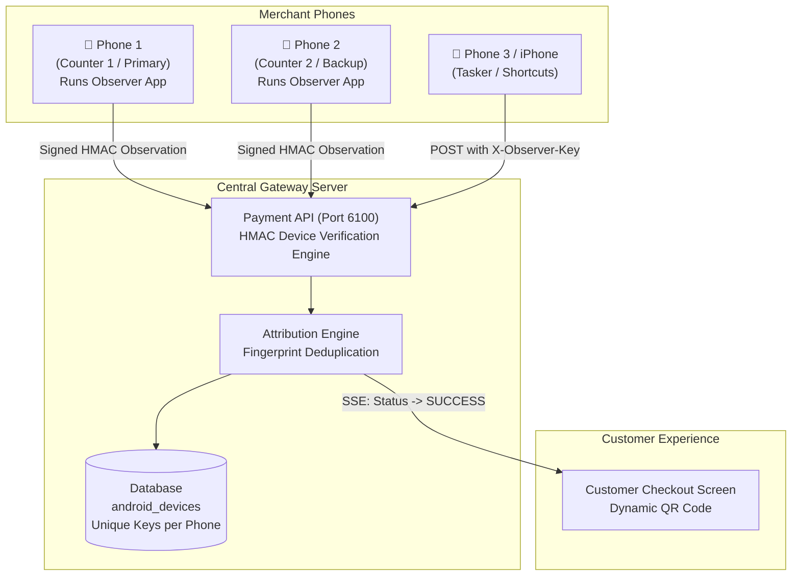

# 📱 Implementing Multi-Phone Payment Receivers

This guide explains how to set up **multiple phones as payment receivers and observers** with your self-hosted payment gateway.

Whether you want **redundancy** (multiple phones listening to the same bank account so no payment is ever missed) or a **multi-counter setup** (different billing counters with their own phones and UPI IDs), this document provides a simple, step-by-step walkthrough.

---

## 🏗️ Architecture Overview



---

## 🎯 Which Setup Do You Need?

| Setup Type | Use Case | How It Works |
| :--- | :--- | :--- |
| **Model A: Redundant Receivers (Same Account)** | 1 Store / Website, 2+ Phones | Both phones receive alerts for the same bank account. Whichever phone gets the SMS/notification first confirms the payment. |
| **Model B: Multi-Counter Setup (Different Accounts)** | Multiple billing desks or branches | Phone 1 receives for `counter1@bank`, Phone 2 for `counter2@bank`. Payments route to the exact desk. |
| **Model C: Mixed Devices (Android + iPhone)** | Store has both Android & iOS staff | Android uses the native Observer APK; iPhone uses iOS Shortcuts automation. |

---

## Model A: Multiple Android Phones with the Observer App (Recommended)

This is the standard, production-ready setup. Each phone gets its own cryptographically signed identity (`deviceId` + unique 256-bit `signingKey`).

### Step 1: Install the APK on All Phones
1. Ensure the gateway server is running:
   ```bash
   npm start
   ```
2. Build or download the Android Observer APK (`youpi-sms-gateway.apk`).
3. Install the APK on **Phone 1**, **Phone 2**, and any additional devices via USB or direct download:
   ```bash
   adb install -r apps/android-observer-app/youpi-sms-gateway.apk
   ```

### Step 2: Pair Phone 1 (Primary Phone)
1. Open the **Merchant Admin Dashboard** at `http://localhost:6001` (or your domain).
2. Navigate to **Observers & Pairing** → Click **+ Pair Android Device**.
3. A pairing QR code will appear on screen.
4. On **Phone 1**:
   - Open the **YOUPI Observer** app.
   - Enter your Gateway API URL (e.g., `https://pay.yourdomain.com` or local `http://192.168.1.50:6100`).
   - Scan the QR code or enter the enrollment token.
   - Set Device Name: `Counter 1 (Pixel 8)`
   - Tap **Pair Device**.
5. Phone 1 will display **Status: CONNECTED (Active Observer)** with a green indicator.

### Step 3: Pair Phone 2 (Secondary / Backup Phone)
1. In the Merchant Admin, click **+ Pair Android Device** again to generate a fresh pairing session.
2. On **Phone 2**:
   - Open the Observer app.
   - Enter the same Gateway API URL.
   - Scan the new QR code.
   - Set Device Name: `Counter 2 (Samsung S23)`
   - Tap **Pair Device**.
3. Both devices will now appear in your Merchant Admin under **Connected Devices**:
   - ✅ `Counter 1 (Pixel 8)` — Heartbeat: Just now
   - ✅ `Counter 2 (Samsung S23)` — Heartbeat: Just now

### Step 4: Essential Android Permissions on Each Phone
To guarantee 24/7 background operation on every phone:
1. **Notification Access**: 
   - Open Observer App → Tap **Grant Notification Listener Permission** → Enable toggle.
2. **Battery Optimization Exemption (Crucial)**:
   - Go to phone **Settings** → **Apps** → **YOUPI Observer**.
   - Tap **Battery** → Select **Unrestricted** (or "Don't Optimize").
   - Enable **Autostart** / **Allow Background Activity** (especially on Xiaomi MIUI, OnePlus OxygenOS, Realme/Oppo ColorOS, and Vivo FuntouchOS).

---

## ⚡ What Happens When a Customer Pays?

1. Customer scans the checkout QR code and completes payment.
2. The bank sends an incoming SMS and app notification (PhonePe, GPay, Paytm, BHIM, Bank SMS).
3. **If both phones receive the notification:**
   - **Phone 1** detects it and dispatches an HMAC-signed observation to the server.
   - The server matches the amount and marks the session **SUCCESS** immediately.
   - **Phone 2** dispatches its observation moments later.
   - The server recognizes the identical UTR / fingerprint via `idx_observations_fingerprint` and **safely deduplicates it** (or upgrades the verification tier to Dual-Channel Level 2).
   - **No duplicate order fulfillment or double charges occur.**
4. **If Phone 1 is out of battery, disconnected, or delayed:**
   - Phone 2 delivers the observation seamlessly without any merchant intervention.

---

## Model B: Multi-Counter Setup (Different UPI IDs per Phone)

If you run multiple physical counters or branches where each phone has a **different bank account or UPI ID**:

### Step 1: Add Receiving Accounts in Merchant Admin
1. Go to **Merchant Admin** → **UPI Accounts**.
2. Register your UPI IDs:
   - Account 1: `counter1@okhdfcbank` (Payee Name: "Store Counter 1")
   - Account 2: `counter2@okhdfcbank` (Payee Name: "Store Counter 2")

### Step 2: Link Phones to Specific Accounts
When pairing each phone or submitting observations, specify the corresponding `receivingAccountId`:
- Phone 1 at Counter 1 listens for notifications to `counter1@okhdfcbank`.
- Phone 2 at Counter 2 listens for notifications to `counter2@okhdfcbank`.

### Step 3: Create Counter-Specific Payment Sessions
When generating a checkout session via API from Counter 1's POS:
```json
POST /api/v1/payments
{
  "orderId": "COUNTER1-ORD-1001",
  "amount": "499.00",
  "receivingAccountId": "00000000-0000-0000-0000-000000000002"
}
```
The QR code generated will display Counter 1's specific VPA, and Phone 1 will verify the payment.

---

## Model C: Lightweight Setup (Without Custom APK / iPhones)

If staff members use iPhones or personal phones where you cannot install the custom APK, use automated webhooks.

### Option 1: Android using MacroDroid / Tasker / SMS Forwarder
1. Install **MacroDroid** or **SMS Forwarder** from Google Play Store or F-Droid.
2. Create a rule:
   - **Trigger**: SMS received from Bank sender (`*HDFC*`, `*SBI*`, `*AXIS*`, `*ICICI*`, `*PhonePe*`, etc.).
   - **Action**: HTTP POST request:
     - **URL**: `https://your-gateway-domain.com/api/v1/pollers/events`
     - **Headers**:
       - `Content-Type: application/json`
       - `X-Observer-Key: YOUR_OBSERVER_INGEST_SECRET`
     - **Body**:
       ```json
       {
         "source": "SMS_GATEWAY",
         "rawText": "{sms_body}",
         "sender": "{sms_sender}"
       }
       ```

### Option 2: iPhone using Apple Shortcuts Automation
1. Open the **Shortcuts** app on iOS → Tap **Automation** → **+**.
2. Select **Message** → Set *Sender* to Bank sender or *Message Contains* to `"credited"`.
3. Set action: **Get Contents of URL**:
   - **Method**: `POST`
   - **URL**: `https://your-gateway-domain.com/api/v1/pollers/events`
   - **Headers**: `X-Observer-Key: YOUR_OBSERVER_INGEST_SECRET`
   - **Request Body (JSON)**:
     - `source`: `"SMS_GATEWAY"`
     - `rawText`: `Shortcut Input` (Message Body)
     - `sender`: `Sender`

---

## 🌐 Network & Remote Connectivity

Phones must be able to reach your gateway backend.

| Deployment | Connection Method | Gateway URL to Enter in Phones |
| :--- | :--- | :--- |
| **Local Store WiFi** | Phones and Server are on the same WiFi router | `http://192.168.1.X:6100` (Use static local IP) |
| **Cloudflare Tunnel (Free)** | Phones use 4G/5G mobile data from anywhere | `https://pay.yourdomain.com` |
| **Cloud VPS** | Hosted on AWS, Hetzner, DigitalOcean, or Railway | `https://api.yourdomain.com` |

> [!TIP]
> For physical retail stores, connecting phones via **Cloudflare Tunnel** or a public domain is strongly recommended. This allows staff phones to switch between store Wi-Fi and 4G/5G mobile data without losing connection to the gateway.

---

## 🔍 Monitoring & Managing Connected Devices

In the **Merchant Admin Dashboard** (`http://localhost:6001` → **Observers & Pairing**):

- **Live Heartbeats**: Each phone pings every 60 seconds (`POST /api/v1/pollers/android/heartbeat`). If a phone goes offline (dead battery / no internet), its status turns **OFFLINE** in real time.
- **Last Seen Observation**: View the exact timestamp when each phone last caught an SMS.
- **Revoke Device**: If a staff member leaves or a phone is lost, click **Unlink Device** to immediately invalidate its cryptographic signing key.

---

## ❓ Frequently Asked Questions (FAQ)

#### Q: How many phones can be connected simultaneously?
There is no hard limit. You can connect 2, 5, 10, or more phones. Each phone receives its own cryptographic key pair.

#### Q: Will two phones confirming the same payment create two orders?
**No.** Every payment session has a unique slot, and incoming observations are deduplicated by `fingerprint_hash` (UTR + account + amount). If Phone 2 sends the same payment 2 seconds after Phone 1, the gateway recognizes the duplicate UTR and ignores it safely.

#### Q: Do the receiver phones need SIM cards for voice calling?
No. They only need an active SIM card capable of receiving SMS messages from banks, or an active internet connection to receive push notifications from UPI merchant apps (PhonePe Business, Google Pay for Business, Paytm for Business).

#### Q: What if a phone restarts?
The Observer APK includes a `BootReceiver` service that automatically launches the background notification listener as soon as the phone finishes booting.

